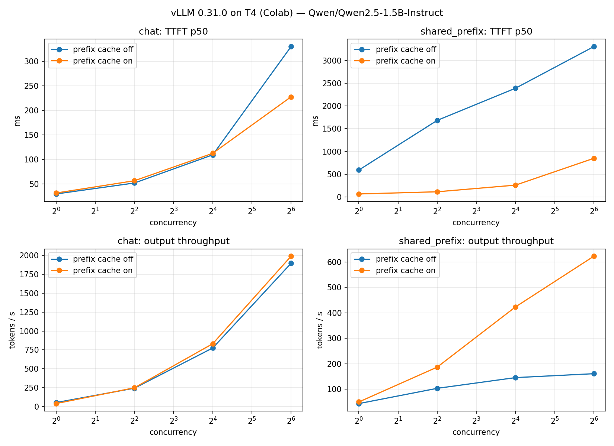

# vLLM Prefix Caching Under Load

**Question:** when does vLLM's automatic prefix caching matter, and by how much, as concurrency rises?

**Short answer:** on traffic that shares a long prompt prefix (RAG over the same document, a long system prompt, agent scaffolding), prefix caching turned an engine that **stopped scaling at ~160 tok/s** into one that kept scaling to **623 tok/s (3.9x)**, and cut **p99 time-to-first-token from 38.8 s to 1.4 s (27x)** at 64 concurrent users. On traffic with unique prompts, it did nothing measurable. It's close to free to turn on, so the real question for a deployment is how much of its traffic shares a prefix.

## Setup

| | |
|---|---|
| Model | Qwen/Qwen2.5-1.5B-Instruct, FP16 |
| Engine | vLLM 0.31.0, OpenAI-compatible server, `--max-model-len 4096`, `--gpu-memory-utilization 0.90` |
| Hardware | 1x NVIDIA T4 16 GB (Google Colab) |
| Variable | `--enable-prefix-caching` vs `--no-enable-prefix-caching` |
| Output | 128 tokens per request, `ignore_eos` so every request does equal decode work |
| Load | closed loop at concurrency 1 / 4 / 16 / 64; max(16, 4 x concurrency) requests per level, after a warm-up batch |

**Workloads**
- `chat`: short prompts (~20 tokens), each starting with a unique ID so no two share a cacheable prefix.
- `shared_prefix`: one ~1.6k-token document followed by a unique question. This stands in for RAG over a hot document or a long system prompt.

**Metrics:** TTFT p50/p99, inter-token latency (ITL) p50/p99, output tokens/s, and estimated $ per 1M output tokens. The cost estimate is GPU time at Modal's T4 list price ($0.000164/s, Oct 2026). This run used free Colab, so it is an estimate, not a bill.

## Results: shared-prefix workload

| Concurrency | TTFT p50 off → on | TTFT p99 off → on | ITL p99 off → on | Throughput off → on | Est. $/1M tokens off → on |
|---|---|---|---|---|---|
| 1 | 593 → 67 ms (8.8x) | 605 → 72 ms | 21 → 22 ms | 43 → 50 tok/s | $3.78 → $3.29 |
| 4 | 1,684 → 115 ms (14.6x) | 2,427 → 141 ms | 562 → 24 ms | 103 → 187 tok/s (1.8x) | $1.59 → $0.88 |
| 16 | 2,390 → 261 ms (9.2x) | 9,890 → 402 ms (24.6x) | 816 → 55 ms | 145 → 423 tok/s (2.9x) | $1.13 → $0.39 |
| 64 | 3,305 → 850 ms (3.9x) | 38,811 → 1,418 ms (27.4x) | 870 → 179 ms | 161 → 623 tok/s (3.9x) | $1.02 → $0.26 |

## Results: chat workload (no shared prefix)

| Concurrency | TTFT p50 off → on | Throughput off → on | Est. $/1M tokens off → on |
|---|---|---|---|
| 1 | 30 → 32 ms | 53 → 40 tok/s | $3.07 → $4.10 |
| 4 | 52 → 57 ms | 243 → 249 tok/s | $0.67 → $0.66 |
| 16 | 109 → 113 ms | 775 → 831 tok/s | $0.21 → $0.20 |
| 64 | 330 → 228 ms | 1,895 → 1,989 tok/s | $0.087 → $0.082 |

Full numbers are in [`results.md`](results.md) and [`results.json`](results.json).

## What the numbers say

1. **Without caching, the shared-prefix workload is prefill-bound and stops scaling.** Throughput goes 103 → 145 → 161 tok/s from concurrency 4 to 64. Each request re-computes the same 1.6k-token document, so the GPU spends most of its time on redundant prefill. With caching, only the ~20-token question is new, and throughput keeps climbing to 623 tok/s.

2. **The tail is where the damage shows.** At concurrency 64 without caching, median TTFT was 3.3 s but p99 was 38.8 s. Requests queue behind a long line of redundant prefills. Caching brought p99 down to 1.4 s, a 27x improvement, larger than the 3.9x improvement at the median. A user-facing service with a p99 SLO would see this first.

3. **Redundant prefill also hurts users who are already streaming.** ITL p99 without caching jumped to 560–870 ms at concurrency 4 and up, versus ~20–55 ms with caching. vLLM schedules new prefills alongside running decodes, so each 1.6k-token prefill stalls token streams for everyone else in the batch. Caching shrinks those prefills, and decode stays smooth.

4. **On unique prompts, caching neither helps nor hurts.** Chat throughput differs by 2–7% at concurrency 4–64, and the single-stream run went the other way (53 → 40 tok/s). With one run per configuration, I read that as run-to-run noise, not a real effect. Chat TTFT at 64 (330 → 228 ms) is the largest gap. The prompts do share a few leading tokens ("Request c64-…"), but that is too short to fill a cache block. I'd treat that gap as noise until repeated runs say otherwise.

5. **Batching matters more than any flag for cost.** On chat, going from 1 to 64 concurrent requests cut estimated cost per token 35x ($3.07 → $0.087 per 1M) while keeping ITL p99 at ~50 ms. Single-stream serving on a GPU is mostly paying for idle compute.

## Caveats

- **One run per configuration.** I didn't measure variance, so small differences (under ~10%) shouldn't be trusted. The shared-prefix effects are large enough to survive that.
- **Best case for caching.** Every shared-prefix request reuses the exact same document. Real traffic would see a partial hit rate, and the gain would scale with it.
- **Small model, old GPU.** A 1.5B model on a T4 is cheap to prefill per token relative to a 70B model on an H100. In absolute terms the effect would differ, though the direction (redundant prefill dominates when prefixes are long and shared) should hold.
- **Startup times aren't comparable.** The first server start (191 s) included downloading weights; the second (112 s) used the local cache.
- **Closed-loop load.** Each client sends its next request when the previous one finishes. An open-loop (Poisson arrival) test would show queueing behavior more realistically under overload.

## Next steps

- Repeat each configuration 3x and report variance.
- Vary the shared-prefix hit rate (25 / 50 / 100%) to estimate the effect on mixed traffic.
- Compare SGLang's RadixAttention on the same workloads.
- Rerun on an L4 / A100 with an 8B model on Modal, measuring real cost and cold start.

## Reproduce

Open `vllm_bench.ipynb` in Google Colab, set the runtime to a T4 GPU, and choose Run all. It takes about 25 minutes including install.
